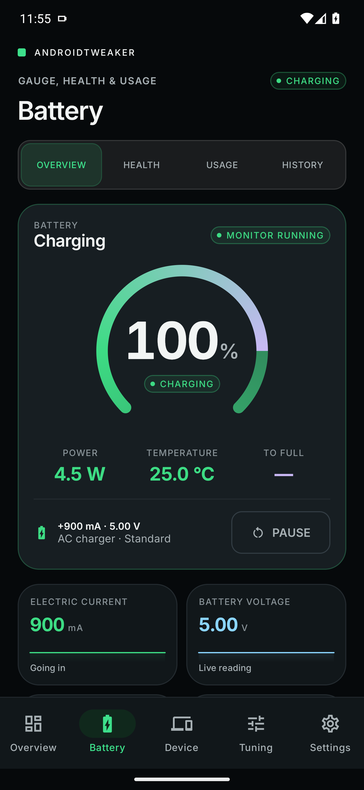
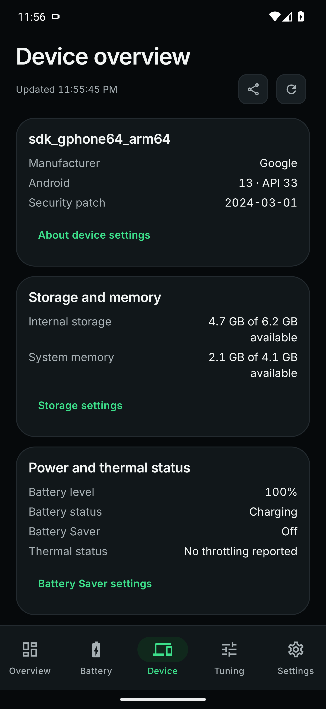

<div align="center">

# AndroidTweaker

### Know your battery. Make every charge count.

See how your phone charges, how its battery is holding up, and how it uses power throughout the day.

**Android 8.0+ · Works without root · Your battery data stays on your device**

[Get the Android app](app/release/androidtweaker.apk) · [Getting started](#your-first-minute) · [Explore the features](#a-clearer-picture-of-your-battery)

</div>

## A clearer picture of your battery

Your battery percentage tells you how much is left. AndroidTweaker helps you understand what happens between charges—with live readings, useful alerts, and a history you can look back on.

**You don't need to know anything about coding. You don't need root to use the battery features.**

| What you want to know | How AndroidTweaker helps |
| --- | --- |
| **How is my phone charging?** | Follow charging speed, temperature, power, and estimated time to full. |
| **How is my battery holding up?** | View estimated battery health and capacity alongside your charging history. |
| **What happens between charges?** | Explore battery drain, screen use, and time spent in deep sleep. |
| **When should I check my phone?** | Set alerts for a full or low battery, a chosen percentage, or temperature changes. |
| **Can I check without opening the app?** | Add a home-screen widget or use the notification and Quick Settings tile. |
| **Can I keep my records?** | Share battery history as a spreadsheet-friendly file or export a backup file. |

Charging summaries and overnight/weekly reports help you look back at your recorded activity. You can also explore device information and optional app-usage statistics.

Health, charging power, and remaining-time figures are estimates. Available readings depend on what your phone reports. App-usage statistics show time spent using apps, rather than the exact battery each app consumed.

## A look inside

<p align="center">
  
  
</p>

Screenshots from an Android emulator. Readings and available details vary by phone.

## Your first minute

1. **Install AndroidTweaker.** Open the [APK file](app/release/androidtweaker.apk) and download it. An APK is an Android app installer; your phone may ask you to allow installation from the browser or file manager you're using.
2. **Open Battery and turn on monitoring.** This starts recording your battery history. Monitoring is off until you enable it.
3. **Allow notifications.** They show battery status and let you receive the alerts you choose.
4. **Use your phone as usual.** Come back after charging and using it to explore your recorded sessions and estimates.

You can pause monitoring from the app, its notification, or the Quick Settings tile. App-usage statistics ask for a separate **Usage Access** permission; you can leave that off.

## More control, when you want it

The everyday battery experience works on a normal Android phone. If you already use advanced Android access tools, AndroidTweaker also offers additional controls.

| Your setup | Extra options |
| --- | --- |
| **Standard phone** | Battery monitoring, health estimates, history, alerts, reports, widgets, and exports. |
| **Shizuku** | Supported system settings and tools through an optional Android access service. |
| **Root access** | Battery, Balanced, Performance, and Gaming profiles, plus supported charging and device controls. |

On compatible rooted phones, charging controls can pause charging at a chosen percentage or temperature while monitoring runs. These controls depend on the phone's hardware and software. The bypass option pauses battery charging; it does not guarantee direct power from the charger. See [charging controls and recovery](docs/specs/07-root-charging-controls.md) before using them.

Connect optional access through **Settings → Device access**. You can continue using the battery features without connecting anything.

## Your history stays yours

Battery records, settings, and diagnostic logs stay on your device. AndroidTweaker does not upload battery telemetry. You choose when to share an export, and you can delete your recorded battery history from the app.

## A few things to know

- **Give it time to collect history.** Some estimates need recorded charging or usage sessions before they can appear.
- **Keep monitoring enabled for history and alerts.** Android or your phone's power-saving settings can interrupt background collection.
- **Backup export is available; importing a backup is not yet supported.**
- **Advanced controls are optional and device-dependent.** They do not promise longer battery life or compatibility with every phone.

## Explore further

Read the [feature guide and specifications](docs/specs/README.md) for how each feature works. The [battery roadmap](docs/specs/11-battery-product-roadmap.md) describes future ideas separately from features available today.

<details>
<summary><strong>For developers and contributors</strong></summary>

The app uses Kotlin, Jetpack Compose, and one Gradle module, with source grouped by feature.

Use **JDK 17** and **Android SDK Platform 36**. Set `JAVA_HOME` and `ANDROID_HOME`, then run:

```sh
make doctor                 # Check your toolchain
make check                  # JVM tests and shell checks
make debug                  # Build a debug APK
./gradlew :app:installDebug  # Install on an ADB-connected device
```

Debug APK: `app/build/outputs/apk/debug/app-debug.apk`.

`make release` stages `app/release/androidtweaker.apk`. Release builds default to the repository's public development key. Configure your own private distribution key using the [release signing guide](app/README.md#release-signing); compatible updates require a compatible signing certificate. Run `./gradlew :app:lintDebug` for Android lint.

- [Source architecture](docs/architecture/README.md)
- [Source map](docs/architecture/source-map.md)
- [Contribution guide](CONTRIBUTING.md)

</details>

## Open source

AndroidTweaker's application source is available under the [MIT License](LICENSE). See [third-party notices](THIRD_PARTY_NOTICES.md) for font attribution and dependency notes.
