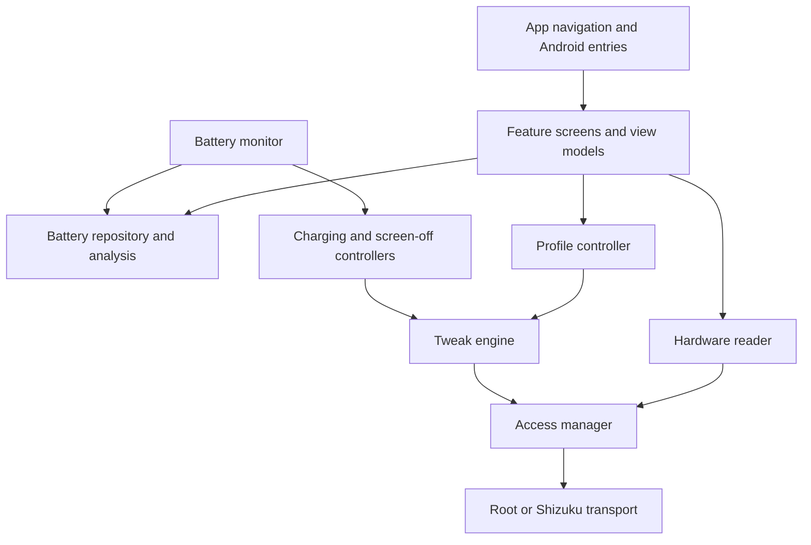

# Simple Battery App Source Architecture Implementation Plan

> **For agentic workers:** Use `superpowers:executing-plans` to implement this plan task by task after design review. Steps use checkboxes. Do not run a repository-wide rename in one operation.

**Goal:** Make AndroidTweaker a readable, battery-first open-source Android project with clear feature ownership, understandable names, and no proven-unused production code.

**Architecture:** Keep one `app` Gradle module and group Kotlin code by feature. Separate Android entry points, feature state, pure calculations, persistence, and privileged execution only where those boundaries make ownership clearer. Migrate incrementally while preserving behavior and installed-app compatibility.

**Tech stack:** Existing Kotlin, Compose Material 3, coroutines, Android framework APIs, JUnit 4 and Android-compatible shell scripts. No new database, dependency-injection framework, navigation library or build modules in this refactor.

**Spec:** [Current feature specifications](../specs/README.md), especially [architecture and validation](../specs/10-architecture-and-validation.md) and [battery product direction](../specs/11-battery-product-roadmap.md). This document proposes a future source structure; it does not replace the current-state specs until implementation lands.

**Status:** Source implementation started and the structural migration is implemented on `refactor/battery-source-architecture`. See [the execution ledger](../architecture/progress.md) for completed source work, validation, deliberate simplifications and outstanding physical-device/release gates. The task checklists below preserve the original proposal; consult the ledger for actual execution status.

## 1. Design choices

| Approach | Benefit | Cost | Decision proposed |
| --- | --- | --- | --- |
| Keep `data/`, `ui/`, `util/` and rename a few files | Smallest diff | Battery behavior remains spread across technical buckets | Insufficient for the requested readability |
| One module with feature packages | A contributor can follow one feature locally; existing build stays familiar | Package boundaries require conventions and review | Recommended |
| Many Gradle feature/domain/data modules | Compiler-enforced dependencies | More build files, wiring and abstractions for about 11,300 Kotlin lines | Defer until a concrete need exists |

The app remains a battery product with optional advanced device tuning. Keep all currently reachable features during the structural migration. “Garbage code” means demonstrably unused or duplicated implementation, not code whose feature is inconvenient to move. Removing a working feature is a product decision and needs its own proposal.

## 2. Findings from the source baseline

The reviewed working tree has around 11,300 Kotlin lines. `BatteryScreen.kt` has 1,483 lines, `BatteryMonitorService.kt` 823, `BenchComponents.kt` 817 and `SystemReader.kt` 654. `Battery.kt` mixes models, Android reads, usage access, calculations and presentation formatting. `Features.kt` mixes settings models, serialization and preferences. `ShizukuAccess.kt` also declares `ShellAccess`. The app-level view model spans privileged access, profiles and hardware.

Names are ambiguous to a new contributor: `TweakerApp` is the Compose shell while `App` is the Android Application; `DashboardScreen` is the performance page, `ToolsScreen` is diagnostics, and `Selection.kt` contains two profile helpers. These observations justify focused extraction, not a clean-room rewrite.

## 3. Global constraints

- Keep `applicationId` and namespace `com.c0d3h01.androidtweaker`.
- Keep min API 26, target/compile API 36, JDK 17 and the checked-in Gradle wrapper.
- Keep two-space Kotlin/shell indentation and Android-compatible `#!/system/bin/sh`.
- Preserve preference filenames, keys, stored enum names, profile codes 1–4, export version and engine runtime paths unless a separate migration is tested.
- Preserve activity destination strings, intent extra/action strings, notification channel/ID values, provider authorities and persisted charging restore records.
- Preserve launcher activity class and published widget/tile component names during the initial refactor; use compatibility wrappers when moving their implementation.
- Keep non-root monitoring usable without a privileged connection. Ordinary screen loads must not request root.
- Keep engine command serialization, UID checks, shell quoting and exit-marker parsing intact.
- Bump `TweakEngine.ENGINE_VERSION` when bundled scripts change; a Kotlin-only move does not require a bump.
- Do not change public branding, signing identity, SDK levels, estimates or feature defaults as incidental cleanup.
- Preserve existing user changes and staged work. Implementation starts from a reviewed snapshot; never reset the current worktree to make this plan easier.

## 4. Proposed source tree

All paths below are relative to `app/src/main/java/com/c0d3h01/androidtweaker/`. Keep features directly named; do not add repetitive `feature/`, `domain/`, `presentation/` layers around every class.

```text
MainActivity.kt                    # stable Android launcher and intent routing
App.kt                             # existing Application entry; remove only if still empty
BootReceiver.kt                    # stable entry, delegates to startup coordinator
BatteryTileService.kt              # stable component wrapper
BatteryWidgetProvider.kt           # stable component wrapper
app/
  AppScreen.kt                     # Compose shell and responsive navigation
  AppDestination.kt                # destinations, section ownership, launch requests
  AppState.kt                      # app-level state only
  AppViewModel.kt                   # startup and cross-feature coordination only
  AppDependencies.kt               # small manual object wiring, if needed
  StartupCoordinator.kt            # monitor startup and authorized boot reapply
battery/
  BatteryModels.kt                  # reading, sample, session, enums
  BatteryReader.kt                  # public API/readable sysfs normalization
  BatteryRepository.kt              # single owner of existing settings/history storage
  BatterySettings.kt                # battery monitor preferences model
  BatteryJson.kt                    # existing persisted format codec
  BatteryExport.kt                  # CSV and JSON file generation
  BatteryViewModel.kt               # visible page state and user actions
  BatteryUiState.kt                 # immutable page snapshot
  BatteryScreen.kt                  # tabs and route only
  BatteryFormatters.kt              # shared battery value formatting
  analysis/
    HealthEstimator.kt             # capacity/health calculation
    ChargeQuality.kt               # current quality and speed heuristics
    DrainEstimator.kt              # rate and time estimates
    ScreenTimeCalculator.kt        # screen/awake/deep-sleep summaries
    UsageReader.kt                 # optional Android UsageStats adapter
  monitor/
    BatteryMonitorService.kt        # Android service lifecycle and foreground contract
    BatteryMonitor.kt               # serialized event loop and state publication
    MonitorPolicy.kt                # adaptive cadence, pure logic
    SessionTracker.kt               # charge/discharge session state machine
    BatteryAlertPolicy.kt           # threshold/latch/cooldown decisions
    BatteryReportPolicy.kt          # opportunistic report decisions
    BatteryNotifications.kt         # channels, icons, notification rendering
    MonitorState.kt                 # STOPPED/STARTING/RUNNING/UNAVAILABLE
  integration/
    BatteryTile.kt                  # tile implementation behind stable wrapper
    BatteryWidget.kt                # widget rendering behind stable wrapper
  ui/
    BatteryOverviewTab.kt           # live metrics, charging and temperature
    BatteryHealthTab.kt             # capacity/health/session panels
    BatteryUsageTab.kt              # usage, app time, care tips and anomaly option
    BatteryHistoryTab.kt            # summary/history/export/delete controls
    BatteryMonitorSettings.kt       # alarms, cadence, icon choices
charging/
  ChargingSettings.kt               # charging subset of existing global preferences
  ChargingController.kt             # root hold/reset orchestration
  ChargingControls.kt               # charge limit/bypass/fuse Compose section
  ChargingState.kt                  # requested/backend/result state; no false verification
  ScreenOffAutomation.kt            # Doze/power/data/background transitions
access/
  AccessMode.kt                     # stored names retained: ROOT/SHIZUKU_ROOT/SHIZUKU/NONE
  AccessManager.kt                  # backend selection and capability checks
  RootConnection.kt                 # explicit root session request and reuse
  RootProcess.kt                    # su process transport
  ShizukuConnection.kt              # manager/auth/UID and command transport
  CommandRunner.kt                  # existing minimal runner contract
  AccessSettings.kt                 # connection UI shared with Settings
engine/
  TweakEngine.kt                    # serialized execution and result handling
  EngineFiles.kt                    # extraction/version/log/runtime paths
  EngineCommands.kt                 # quoted dispatcher invocation and exit parser
  EngineCommandPolicy.kt            # root requirements, centralized
  EngineResult.kt                   # result model
profiles/
  Profile.kt                       # existing code/name identity
  ProfileSettings.kt               # groups/overrides model
  ProfileGroup.kt                  # sections, group descriptions, presets
  ProfilePreferences.kt            # existing persisted profile/boot state
  ProfileSettingsStore.kt          # existing per-profile persistence/conf output
  ProfileController.kt             # pending/applying/confirmed state
  ProfileApplyService.kt            # foreground boot application, keeps intent constants
  ProfileScreen.kt                 # group editor and apply UI
  ProfileSelection.kt              # only if the live controller needs it
  ProfileRequestTracker.kt         # only if live latest-request arbitration needs it
tuning/
  TuningSettings.kt                 # remaining global feature switches
  TuningStore.kt                    # existing preference layout preserved
  FeatureConfigWriter.kt           # same generated features.conf, one writer
  TuningScreen.kt                   # profiles/features container
  PowerControls.kt                 # Doze, saver and whitelist UI
  SystemControls.kt                # cleanup/logging/phantom/bloat UI
  NetworkControls.kt               # Wi-Fi/scan UI
  DisplayControls.kt               # resolution/refresh UI
  AppProfileControls.kt            # heavy/light lists and package picker
  ThermalControls.kt               # current advanced thermal option
  PackagePicker.kt                 # package selection, no shell mutation
home/
  OverviewScreen.kt                 # current home summary and shortcuts
device/
  DeviceScreen.kt                   # current public device overview
  DeviceInfo.kt                     # overview models and public framework reader
  HardwareReader.kt                # existing shell/sysfs telemetry acquisition
  HardwareSnapshot.kt              # telemetry models and parsing helpers
  HardwareViewModel.kt             # visible-only sampling and chart histories
  HardwareScreen.kt                # CPU/GPU/thermal/memory/battery view
  PerformanceScreen.kt             # current DashboardScreen functionality
settings/
  SettingsScreen.kt                 # access, boot, diagnostic links
  DiagnosticsScreen.kt              # current ToolsScreen
  EngineLogScreen.kt                # current LogsScreen
  ActivityNotifications.kt          # current ActivityNotifier
ui/
  theme/AppTheme.kt
  theme/AppColors.kt
  theme/AppTypography.kt
  components/PageLayout.kt
  components/Panel.kt
  components/Controls.kt
  components/Charts.kt
  components/StatusChip.kt
  components/MetricRow.kt
common/
  TimeFormatters.kt                # shared non-battery time formatting only
```

This is an ownership map, not a quota of files to create. Omit a proposed file if its responsibility remains a short, cohesive part of its owner. Do not create empty folders, one-method forwarding layers or interfaces with no useful test/substitution boundary. Split large Hardware/Diagnostics composables further only when independent panels become hard to follow.

## 5. Dependency rules and flow



- Android components own lifecycle; they delegate calculations and decisions to plain Kotlin objects.
- Feature screens render state and emit actions. They do not read preferences, create exports, run shell commands or launch private IO loops directly.
- BatteryReader remains public-API/readable-file based. A future root battery reader must be a separately named, capability-tested adapter.
- Battery analysis has no Compose, Context, root or Shizuku dependency. Android usage reading stays an adapter, not a pure calculator.
- Engine does not import screens/view models. Access does not import engine or feature settings.
- Charging does not import monitor/service/UI types. ScreenOffAutomation lives beside charging during migration but remains a separate controller with distinct ownership.
- Shared UI contains reusable presentation only. Feature-specific panels stay with their feature.
- One monitor owns background sampling; one hardware state owner samples while visible. Screen refresh must not create another background recorder.
- Settings composition may call feature-owned connection controls. Cross-feature navigation goes through callbacks/destination values, not screen-to-screen calls.

## 6. Exact migration map

`K/` means the current Kotlin package root above; all destinations are under that root.

| Current source | Proposed owner/name | Change |
| --- | --- | --- |
| `K/TweakerApp.kt` | `app/AppScreen.kt`, `app/AppDestination.kt` | Extract routing; preserve destination keys |
| `K/TweakerViewModel.kt` | `app/AppViewModel.kt`, `profiles/ProfileController.kt`, `device/HardwareViewModel.kt` | Split ownership, then remove obsolete coordinator fields |
| `K/data/Battery.kt` | `battery/BatteryModels.kt`, `BatteryReader.kt`, `BatteryFormatters.kt`, `analysis/*.kt` | Move existing declarations without algorithm edits |
| `K/data/BatteryStore.kt` | `battery/BatteryRepository.kt`, `BatterySettings.kt`, `BatteryJson.kt`, `BatteryExport.kt` | Preserve storage/codec/output behavior first |
| `K/BatteryMonitorService.kt` | `battery/monitor/*` | Extract state machine/policies before moving service |
| `K/ui/BatteryScreen.kt` | `battery/BatteryScreen.kt`, `BatteryViewModel.kt`, `battery/ui/*` | Route → state → four tabs; no feature deletion |
| `K/data/Features.kt` | `charging/ChargingSettings.kt`, `tuning/TuningSettings.kt`, `TuningStore.kt`, `FeatureConfigWriter.kt` | Split model ownership; keep one compatible preference/config codec |
| `K/data/FeatureEnforcer.kt` | `charging/ChargingController.kt`, `ScreenOffAutomation.kt` | Separate charging restoration from screen transitions |
| `K/util/ShizukuAccess.kt` | `access/ShizukuConnection.kt`, `AccessManager.kt`, `AccessMode.kt` | Separate backend from selector; keep stored enum names |
| `K/util/RootShell.kt` | `access/RootConnection.kt` | Rename; keep explicit-request behavior |
| `K/util/SuProcessRunner.kt` | `access/RootProcess.kt` | Rename and update runner users |
| `K/util/RootCheck.kt` | `access/CommandRunner.kt` | Keep live UID check beside runner, not a separate utility file |
| `K/data/ShellRunner.kt` | `access/CommandRunner.kt` | Rename contract and imports together |
| `K/data/TweakEngine.kt` | `engine/TweakEngine.kt`, `EngineFiles.kt`, `EngineCommandPolicy.kt`, `EngineResult.kt` | Extract without weakening mutex/UID guards |
| `K/data/TweakCommands.kt` | `engine/EngineCommands.kt` | Rename; retain command quoting/parser contract |
| `K/data/Profile.kt` | `profiles/Profile.kt` | Move only |
| `K/data/ProfilePreferences.kt` | `profiles/ProfilePreferences.kt` | Move only; preserve boot eligibility |
| `K/data/TweakGroups.kt` | `profiles/ProfileGroup.kt`, `ProfileSettings.kt`, `ProfileSettingsStore.kt` | Split metadata/model/storage |
| `K/data/Selection.kt` | conditional `profiles/ProfileSelection.kt`, `ProfileRequestTracker.kt` | Remove unused declarations if no production caller |
| `K/data/BootProfile.kt` | deletion candidate | Currently appears referenced only by tests; repeat full reference audit |
| `K/TweakApplyService.kt` | `profiles/ProfileApplyService.kt` | Update manifest, boot intent and notification callers atomically |
| `K/ui/TweaksScreen.kt` | `tuning/TuningScreen.kt`, `profiles/ProfileScreen.kt` | Split container from profile editor |
| `K/ui/FeatureSections.kt` | `charging/ChargingControls.kt`, `tuning/*Controls.kt`, `PackagePicker.kt` | Group controls by feature; keep action confirmations |
| `K/ui/DashboardScreen.kt` | `device/PerformanceScreen.kt` | Name matches actual page |
| `K/ui/DeviceOverviewScreen.kt` | `device/DeviceScreen.kt` | Rename |
| `K/data/DeviceOverview.kt` | `device/DeviceInfo.kt` | Retain public framework reader |
| `K/data/SystemReader.kt` | `device/HardwareReader.kt` | Rename; split parsing by subsystem only when useful |
| `K/data/Telemetry.kt` | `device/HardwareSnapshot.kt` | Keep units/parsers documented |
| `K/ui/HardwareScreen.kt` | `device/HardwareScreen.kt` | Move and connect feature-owned state |
| `K/ui/OverviewScreen.kt` | `home/OverviewScreen.kt` | Move |
| `K/ui/SettingsScreen.kt` | `settings/SettingsScreen.kt` | Move |
| `K/ui/ToolsScreen.kt` | `settings/DiagnosticsScreen.kt` | Match navigation label |
| `K/ui/LogsScreen.kt` | `settings/EngineLogScreen.kt` | Clarify log scope |
| `K/ActivityNotifier.kt` | `settings/ActivityNotifications.kt` | Clarify notification scope |
| `K/ui/BenchComponents.kt` | `ui/components/*`, `ui/theme/*` | Extract cohesive UI primitives; remove Bench naming from internal APIs |
| `K/ui/Theme.kt` | `ui/theme/AppTheme.kt`, `AppColors.kt`, `AppTypography.kt` | Keep visual behavior |
| `K/util/TimeFormat.kt` | `common/TimeFormatters.kt` | Audit overlap with battery formatting before consolidation |
| `K/App.kt` | retain or remove manifest declaration + class | Empty Application is not useful wiring by itself |

Tests move to matching packages. Existing assertions remain; update imports/class references instead of discarding tests to make compilation pass.

## 7. Assets, resources and compatibility

Keep `assets/tweaker/`, extracted `files/tweaker/`, `custom/*.conf`, `charge.restore`, `charge.reason`, `tweaks.log`, dispatcher command names and shell profile filenames during this refactor. Their names are runtime contracts; a cosmetic `engine/` rename is not worth an installed-state migration. Simplify Kotlin ownership around them first.

Retain Android resource IDs initially. Resource XML can be regrouped into `battery_strings.xml`, `tuning_strings.xml`, `device_strings.xml` and `app_strings.xml` without changing IDs. Move hardcoded UI text into resources in a separate reviewed patch; keep existing English wording and placeholder units. Resource file grouping must not create duplicate string names.

Keep root-level `MainActivity`, `BatteryTileService`, `BatteryWidgetProvider` and `BootReceiver` component identities. Delegate tile/widget work into feature packages. Do not rename the widget receiver and lose existing launcher instances. Service moves require matching manifest/explicit-intent updates; stop/restart monitoring cleanly on app upgrade and exercise pending notification actions.

Do not rename `ROOT`, `SHIZUKU_ROOT` or other persisted access enum values. Confirm every saved key/path/intent/channel value with a checked-in compatibility inventory before touching consumers. Compose route names can improve while external string keys remain stable.

## 8. Dead-code and simplification policy

Initial candidates, not authorized blanket deletions:

| Candidate | Evidence seen | Required decision/check |
| --- | --- | --- |
| `BootProfile` | Search found test callers and declaration, no current production caller | Recheck source/manifest/scripts; delete helper and tests solely asserting its dead behavior |
| `TapArbiter`, `ProfileSelection` | Search found standalone tests; live view model must be inspected for equivalent logic | Keep or consolidate only the version that owns actual pending/confirmed behavior |
| Empty `App : Application` | Manifest references it, so it is not unreachable | Either use it for actual manual wiring or remove both registration and empty class |
| Duplicate formatting/readers | Similar responsibilities in multiple files | Compare units, null handling, sign and locale before sharing |
| Old comments/default descriptions | Recommended-preset comment does not match implementation | Correct comments to tested behavior; do not silently alter behavior |
| Generic UI primitives | Large shared file includes mixed responsibilities | Move live primitives; delete only symbols with no source/resource/reflective callers |

Search all source sets, manifests, resource XML, tests, Gradle, scripts, documentation and string-based/reflection use. Compilation alone does not prove a manifest receiver or dispatcher command is unused. Do not remove bundled engine groups, profiles, charging recovery files, migration readers or root checks simply because no Kotlin symbol references them directly.

Avoid `Manager`, `Helper`, `Utils`, `Base*` and generic `Repository<T>` names. Prefer names stating the job. Keep comments for units, OEM differences, invariants and recovery; remove comments that merely narrate obvious assignments. Do not force a fixed line limit or create a file per trivial data class.

## 9. Proposed internal seams

These are new internal APIs to establish during extraction; adapters preserve current implementations. Introduce only when the owning task needs them.

```kotlin
// battery/BatteryReader.kt — interface for fake readings; Android adapter implements it.
interface BatterySource { fun read(): BatteryReading }

// battery/monitor/SessionTracker.kt — existing algorithm, explicit monotonic inputs.
class SessionTracker {
  fun onReading(reading: BatteryReading, elapsedMs: Long, deepSleepMs: Long): List<BatterySession>
  fun finish(reading: BatteryReading, elapsedMs: Long, deepSleepMs: Long): List<BatterySession>
}

// battery/monitor/BatteryAlertPolicy.kt — no Android notifications in policy.
class BatteryAlertPolicy {
  fun evaluate(reading: BatteryReading, previous: BatteryReading?, settings: BatterySettings, nowMs: Long): List<BatteryAlert>
}

// access/CommandRunner.kt — initially preserve synchronous transport contract.
fun interface CommandRunner { fun run(command: String): String }

// access/AccessManager.kt — explicit connection actions remain separate.
fun runnerOrNull(requireRoot: Boolean = false): CommandRunner?
```

`BatteryAlert` is a feature-owned sealed type with Full, Low, Level, HighTemperature and LowTemperature variants containing the values needed for notification rendering. Preserve latch/reset/cooldown behavior. Anomaly and scheduled reports remain in their report policy until independently extracted. Do not turn a requested control into a Verified state without actual read-back.

BatteryRepository first retains existing `settings`, `update`, `samples`, `sessions`, `addSample`, `addSession`, `deleteHistory`, summary and report-marker operations with existing arguments/results. Rename call sites atomically; do not introduce a second cache/store. BatteryViewModel publishes `StateFlow<BatteryUiState>` containing reading, settings, history, usage-access status, apps and monitor state. It exposes `setMonitoring(Boolean)`, `updateSettings((BatterySettings) -> BatterySettings)` and `deleteHistory()`; sharing returns generated files to an Android share launcher. No Activity context is retained in the view model.

## 10. Ordered implementation tasks

Each task is a separate reviewable commit. Mechanical moves use existing tests plus build/lint; new extraction seams receive focused behavior tests. Do not invent tests that only assert filenames. Preserve existing failing baseline checks as explicit blockers or known baseline issues rather than hiding them.

### Task 1: Capture baseline and compatibility contracts

**Files:** `docs/architecture/compatibility.md`, `docs/architecture/source-map.md`; current tests/build/manifest/preferences.

- [ ] Inspect git status and preserve the existing staged/unstaged work; choose an isolated implementation branch/worktree from the intended baseline.
- [ ] Run `make check` and `./gradlew :app:assembleDebug :app:lintDebug`; record actual outcomes and existing failures.
- [ ] Inventory preferences, enum names, intent actions/extras, component names, channels/IDs, engine paths, export schema and signing certificate expectations without recording secrets.
- [ ] Capture main-page screenshots and scripted manual flows for no-root and available privileged modes.
- [ ] Record production callers for deletion candidates and the current pending/confirmed profile behavior.
- [ ] Commit only the compatibility/source inventory. Deliverable: a reproducible baseline and explicit preserved contracts.

### Task 2: Establish readable app shell and access packages

**Files:** `app/AppScreen.kt`, `AppDestination.kt`, `access/*.kt`, `MainActivity.kt`, manifest and matching access tests; move current RootShell/ShizukuAccess/ShellRunner implementations.

**Interfaces:** Produces `CommandRunner.run(String): String`, `AccessManager.runnerOrNull(Boolean): CommandRunner?`; preserves all existing mode names/capability semantics.

- [ ] Move runner/backend/mode declarations into their named owners; update imports and explicit class references together.
- [ ] Rename the Compose shell to AppScreen and extract destinations, keeping every external destination string unchanged.
- [ ] Keep root authorization tied to explicit connection/authorized boot actions.
- [ ] Run existing shell-access/process tests plus debug build/lint; check no-root startup and repeated notification routing.
- [ ] Commit `refactor: group app navigation and privileged access`.

### Task 3: Extract battery models, readers and pure calculations

**Files:** `battery/BatteryModels.kt`, `BatteryReader.kt`, `BatteryFormatters.kt`, `analysis/*.kt`; move/split `data/Battery.kt` and existing BatteryTest.

**Interfaces:** Produces existing BatteryReading/Sample/Session types and calculation signatures unchanged; introduces BatterySource only for the monitor extraction's fake input boundary.

- [ ] Move declarations without changing constants, confidence labels, math or sensor normalization.
- [ ] Separate UsageReader's Android dependencies from pure estimators.
- [ ] Move current assertions into focused health/drain/format tests; retain null/outlier/threshold expectations.
- [ ] Run `./gradlew :app:testDebugUnitTest :app:assembleDebug` and compare displayed values with baseline fixtures.
- [ ] Commit `refactor: separate battery readings and calculations`.

### Task 4: Isolate battery persistence and exports

**Files:** `battery/BatteryRepository.kt`, `BatterySettings.kt`, `BatteryJson.kt`, `BatteryExport.kt`; current `BatteryStore.kt` consumers and new codec fixtures/tests.

**Interfaces:** Preserve current store method signatures and storage representation under the new owner. Export functions still return cache Files; no new import feature.

- [ ] Add legacy JSON fixtures exercising absent/unknown fields, null metrics, settings and session/sample values; assert load/serialize preservation at the codec boundary.
- [ ] Extract the existing codec, repository and export responsibilities; preserve one cache and synchronization owner.
- [ ] Test loading populated old preferences and verify that refactoring neither erases history nor resets settings.
- [ ] Run JVM tests and debug build. Keep the known CSV mismatch unchanged here; record its separate follow-up.
- [ ] Commit `refactor: clarify battery storage and export ownership`.

### Task 5: Decompose the monitor without changing lifecycle

**Files:** `battery/monitor/*`, `BatteryMonitorService.kt` manifest declaration/consumers, focused SessionTracker/AlertPolicy/MonitorPolicy tests.

**Interfaces:** Produces SessionTracker and BatteryAlertPolicy contracts from section 9. MonitorState retains all four existing states. Service remains owner of foreground promotion and lifecycle cancellation.

- [ ] Add characterization tests for charge→plugged-idle→unplug, missing level, sessions under 45 seconds, counter fallback and screen/deep-sleep deltas.
- [ ] Add alert tests for upward/downward threshold crossings, low/full rearming, temperature cooldown and unknown metrics; use explicit timestamps.
- [ ] Extract session and alarm/report policies, notification rendering, then serialized event loop. Preserve batching, sample spacing, sticky/start failure behavior and charging-release ordering.
- [ ] Update manifest and every explicit service intent atomically; retain intent action strings.
- [ ] Run JVM tests, shell charging simulation, debug build/lint and monitor start/pause/boot/manual interruption checks.
- [ ] Commit `refactor: separate battery monitor lifecycle and policies`.

### Task 6: Split battery page into route, state and four tabs

**Files:** `battery/BatteryViewModel.kt`, `BatteryUiState.kt`, `BatteryScreen.kt`, `battery/ui/*.kt`; app destination wiring.

**Interfaces:** Produces StateFlow<BatteryUiState> and actions described in section 9; consumes repository, source and monitor-state APIs from tasks 3–5.

- [ ] Move current visible polling, usage refresh and store actions into the view model, retaining visibility cancellation and current refresh cadence.
- [ ] Extract Overview/Health/Usage/History tabs and monitor settings; keep UI-specific dialogs and share launchers at the Android UI boundary.
- [ ] Preserve tab state, permission requests, empty states, deletion confirmation and the current export/backup scope.
- [ ] Run JVM tests and debug build/lint; manually compare all four tabs, grant/revoke Usage Access and navigate away/back.
- [ ] Commit `refactor: group battery pages and screen state`.

### Task 7: Separate charging, screen automation and tuning settings

**Files:** `charging/*.kt`, `tuning/TuningSettings.kt`, `TuningStore.kt`, `FeatureConfigWriter.kt`; split current Features/FeatureEnforcer and FeatureSections; keep shell assets unchanged.

**Interfaces:** ChargingController owns hold/reset calls; ScreenOffAutomation owns screen-transition flags. One FeatureConfigWriter combines ChargingSettings and TuningSettings into the existing features.conf keys.

- [ ] Add golden config fixtures and tests showing old preferences generate the same shell config, package sanitization and disabled defaults.
- [ ] Test disabled charging rules request owned-hold release, ADB-only backend cannot charge-control, and screen automation does not authorize root implicitly.
- [ ] Split models/controllers/UI by responsibility while keeping persistence keys and feature command ordering.
- [ ] Run JVM suite and `make test-shell`; manually test denial, missing nodes and supported root hold/release when a rooted device is available.
- [ ] Commit `refactor: separate charging controls from tuning features`.

### Task 8: Isolate engine and profile ownership

**Files:** `engine/*.kt`, `profiles/*.kt`, `tuning/TuningScreen.kt`; current TweakEngine, TweakCommands, TweakGroups, profile selection/service and view-model consumers.

**Interfaces:** Preserve serialized apply/command results, profile codes, preference contracts and root-required command policy. ProfileController owns confirmed/pending state formerly coordinated by TweakerViewModel.

- [ ] Preserve command/parser tests and add a focused regression if pending-request/failure behavior lacks live coverage before moving it.
- [ ] Extract engine files/commands/policy/results, then profile storage/controller/UI and apply service. Keep asset/runtime names unchanged.
- [ ] Verify rapid profile requests, failed apply rollback, denied root, ADB command restrictions, stale boot eligibility and command serialization.
- [ ] Update service manifest/boot callers and run full JVM suite, shell simulation, debug build/lint.
- [ ] Commit `refactor: group profile application and engine execution`.

### Task 9: Group device, settings and shared presentation

**Files:** `device/*`, `settings/*`, `home/*`, `ui/components/*`, `ui/theme/*`, `common/TimeFormatters.kt`; old UI/data/util consumers.

**Interfaces:** HardwareViewModel owns visible-only hardware sampling and histories; app state delegates rather than retaining duplicate samples. Existing public device reader behavior remains unchanged.

- [ ] Rename Dashboard→Performance, Tools→Diagnostics and Logs→EngineLog while preserving route keys and user features.
- [ ] Move telemetry acquisition/models beside device pages; keep public device reads distinct from shell hardware reads.
- [ ] Extract reusable panels/charts/controls and theme primitives; retain feature panels locally and preserve visual layout.
- [ ] Regroup string XML by feature and move hardcoded battery text with resource placeholders in a separate commit from mechanical class moves.
- [ ] Run parser/JVM tests, build/lint and page visibility/navigation/sharing checks. Confirm no hardware polling persists after leaving its page.
- [ ] Commit focused device/settings and shared-UI changes separately.

### Task 10: Remove proven-unused code and temporary migration adapters

**Files:** audited candidates from section 8, obsolete old package files, redundant transitional imports/adapters/tests; compatibility inventory.

- [ ] Repeat full-tree reference searches after all moves, including manifest/resource/reflective/script uses.
- [ ] Delete BootProfile/selection helpers only if no live consumer remains; remove tests that exclusively exercise removed dead helpers, retaining equivalent live behavior tests.
- [ ] Resolve empty Application registration: keep only for actual wiring, otherwise remove its manifest attribute and class together.
- [ ] Remove superseded adapters and duplicate formatters only after all callers use the tested canonical implementation; retain component wrappers that preserve Android identity.
- [ ] Run `make check`, debug build/lint and a full route/component smoke test. Record exactly what was deleted and why in the PR.
- [ ] Commit `refactor: remove verified unused source`.

### Task 11: Prepare contributor and release documentation

**Files:** root/app README, AGENTS.md, `CONTRIBUTING.md`, `docs/architecture/README.md`, source/compatibility maps, existing specs and CI/release instructions.

- [ ] Add a “start reading here” path: MainActivity → AppScreen → battery page/view model → monitor → repository/calculators → optional charging/access/engine.
- [ ] Explain package ownership, one feature walkthrough, test commands, private signing setup and how to add a screen/control safely. Update AGENTS.md source paths.
- [ ] Preserve LICENSE and document licenses/notices for bundled fonts/assets and dependencies; resolve any missing notices before public distribution.
- [ ] Explain that committed development signing material is public; keep private distribution credentials out of examples/logs and preserve existing-install certificate compatibility.
- [ ] Document contribution/review conventions, device compatibility evidence and where to report sensitive security issues. Do not invent a maintainer contact or a new license.
- [ ] Keep CI building/testing/linting pull requests. Add unsigned release assembly validation if needed; publishing a signed artifact remains an explicit release action.
- [ ] Update current-state specs only to implemented ownership/behavior; keep future reliability work labeled proposed.
- [ ] Verify all local documentation links, `git diff --check`, `make check`, debug/release assembly and lint. Commit `docs: explain source architecture and contribution workflow`.

## 11. Review focus

| Failure mode | Expected outcome | Owning task |
| --- | --- | --- |
| Existing preferences/history from pre-refactor APK | Same settings, samples, session identities and boot eligibility | 1, 4, 8 |
| Existing widget/tile/pending notification references | Same registered component identities and routing/action behavior | 2, 5, 9 |
| Root denied or Shizuku backend lost mid-operation | Public battery UI remains useful; protected commands fail visibly | 2, 7, 8 |
| Plugged-but-idle/charge hold/process stop | Session math remains consistent and pause attempts owned-hold release | 5, 7 |
| Rapid profile requests while one command fails | Confirmed profile is not replaced by stale/failed pending state | 8 |

## 12. Deferred behavior work

Do not mix the following into mechanical moves: crash-safe session checkpoints, historical database migration, CSV schema correction, active-session deletion semantics, refresh-setting reconciliation, changed health heuristics, read-back verified charge capability, backup restore, durable automation ownership or removal of thermal/cleanup features. These are valuable follow-ups from the battery roadmap, but each needs a distinct behavior specification, regression test and review.

## 13. Completion and release gates

- Every feature in docs/specs has a source owner and a reachable page/action after migration.
- No broad `data/` or `util/` dumping ground remains; no obsolete imports or temporary forwarding types remain except intentional Android component compatibility wrappers.
- A contributor can follow one feature without reading the app-wide view model or a 1,500-line screen.
- Pure calculations can be tested without Android/root; all existing behavior assertions still pass or have a documented equivalent.
- Existing preferences/engine restore records remain readable, and upgrades use the intended compatible certificate.
- Fresh-install and upgrade flows pass on a non-root device; rooted charging/boot functionality has separately recorded physical-device results or is explicitly unverified.
- Debug build, JVM suite, shell syntax/simulation, release assembly and lint pass. A shared-key release build is not evidence of private distribution readiness.
- Source/feature documentation and screenshots reflect the final implementation. Release notes distinguish refactoring from behavior changes.
- Public publication, remote pushes and release uploads are not performed merely because this plan exists.

## 14. Suggested delivery sequence

Deliver three milestones: (A) ownership and naming, tasks 1–4; (B) battery/service/privileged state extraction, tasks 5–8; (C) supporting pages, verified cleanup and contributor readiness, tasks 9–11. Each intermediate commit must build. Prefer single-threaded implementation because package moves and shared contracts overlap heavily; review each milestone before the next.
